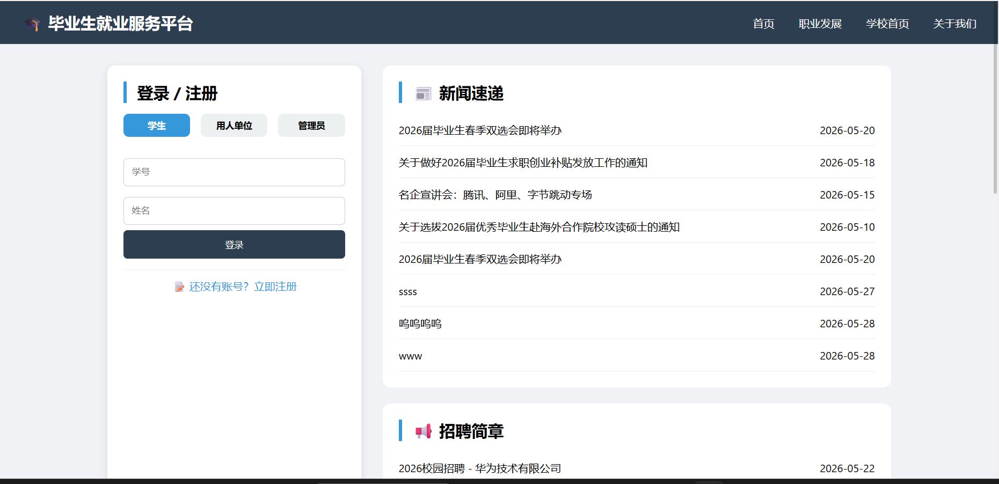

# 毕业生就业管理系统

## 一、项目简介

本项目是一个基于 Spring Boot 的 Java Web 学习项目，围绕毕业生就业相关业务进行开发，包含学生、企业、管理员等不同角色的功能模块。

项目主要用于学习 Web 应用开发、数据库操作及多角色业务逻辑。

## 二、技术栈

- Java 17
- Spring Boot
- Spring Data JPA
- MySQL
- Thymeleaf、HTML、CSS、JavaScript
- Maven

## 三、项目主要模块

### 1. 学生端
- 学生相关业务页面
- 个人信息及就业相关功能

### 2. 企业端
- 企业管理页面
- 招聘信息相关功能
- 简历接收相关页面

### 3. 管理员端
- 管理员控制页面
- 招聘信息管理相关功能

## 四、项目结构

- controller：处理页面访问和业务请求
- entity：定义业务实体
- repository：负责数据库访问
- templates：存放前端页面模板
- static：存放静态资源

## 五、项目运行

本项目使用 Java 17、Spring Boot 和 MySQL。

运行前需要配置本地数据库连接信息，并在 IDEA 中启动 GraduateApplication。

具体数据库初始化方式、运行地址及环境要求将根据项目实际配置继续完善。

## 六、项目运行截图

### 系统首页及登录页面

## 七、项目说明

本项目用于个人学习和课程实践，部分功能及代码结构仍在持续学习和完善中。
  